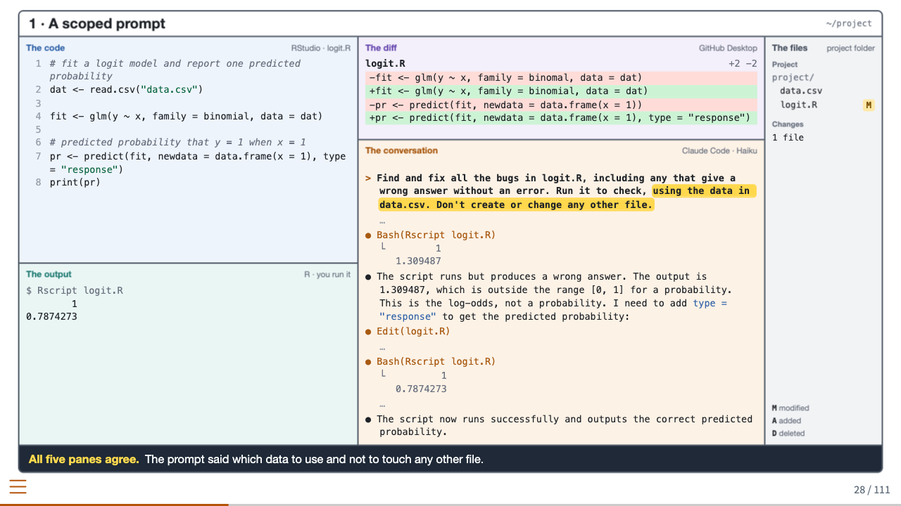
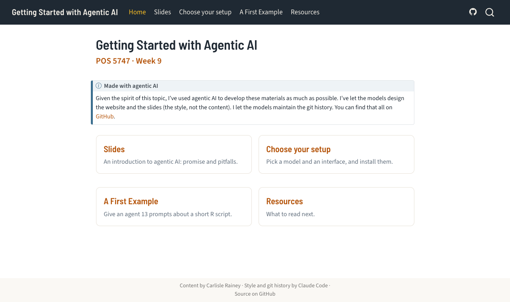

# Getting Started with Agentic AI

**[pos5747.github.io/agentic-ai](https://pos5747.github.io/agentic-ai/)** · [Slides](https://pos5747.github.io/agentic-ai/slides/slides.html) · POS 5747, Florida State University

[](https://quarto.org)
[](https://code.claude.com/docs/en/overview)
[](https://pos5747.github.io/agentic-ai/)

Materials for week 9 of POS 5747, a political science PhD course on probability models: a lecture on what agents do well and badly, then how to set up a coding agent, a first exercise with it, and a list of resources.

<p align="center">
  
</p>

## Made with agentic AI

> Given the spirit of this topic, I've used agentic AI to develop these materials as much as possible. I've let the models design the website and the slides (the style, not the content). I let the models maintain the git history.

In practice, that means:

- **The look** of the site and the slides (fonts, colors, the cards on the home page, the five-pane "agent workspace" slides) was designed and written by Claude Code, in [`theme.scss`](theme.scss), [`slides/src/theme.scss`](slides/src/theme.scss), and the filters and styles in [`slides/src/`](slides/src).
- **The git history** is Claude Code's: it renders the site, reads the diff, writes the commit message, and pushes. Every commit carries a `Co-Authored-By` line.
- **The content** (what the pages and slides say) is Carlisle Rainey's.
- **Every agent run on the slides is real.** The conversations, diffs, and outputs come from logged runs of Claude Code and OpenCode on short R scripts, and the agents' words are quoted verbatim.

## What's here

| Page | What it does |
|---|---|
| [Slides](https://pos5747.github.io/agentic-ai/slides/slides.html) | "An Introduction to Agentic AI: Promise and Pitfalls" |
| [Choose your setup](https://pos5747.github.io/agentic-ai/setup.html) | Pick a model (gpt-oss, qwen, or Claude) and an interface (OpenCode or Claude Code) |
| Five install pages | One Windows block and one Mac block per pair, then a one-line check |
| [A First Example](https://pos5747.github.io/agentic-ai/first-example.html) | Give an agent 13 prompts about a buggy R script, and check what it did |
| [Resources](https://pos5747.github.io/agentic-ai/resources.html) | What to read next, by person, roughly in order of value to a beginner |

<p align="center">
  
</p>

## Build

The site is a [Quarto](https://quarto.org) website; the slides are a revealjs deck inside it.

```sh
./render.sh        # renders the pages and the deck into docs/
```

GitHub Pages serves `docs/` from `main`. The five-pane slides are written as plain-text blocks and built by a Lua filter, [`slides/src/agent-gui.lua`](slides/src/agent-gui.lua); its header documents the syntax.

```
.
├── _quarto.yml, theme.scss   site config and theme
├── index.qmd, setup.qmd, first-example.qmd, resources.qmd
├── claude-code-*.qmd, opencode-*.qmd   the five install pages
├── _partials/                text shared by A First Example
├── slides/
│   ├── slides.qmd            the deck
│   └── src/                  filters, CSS, and the deck's theme
└── docs/                     the rendered site (what Pages serves)
```
